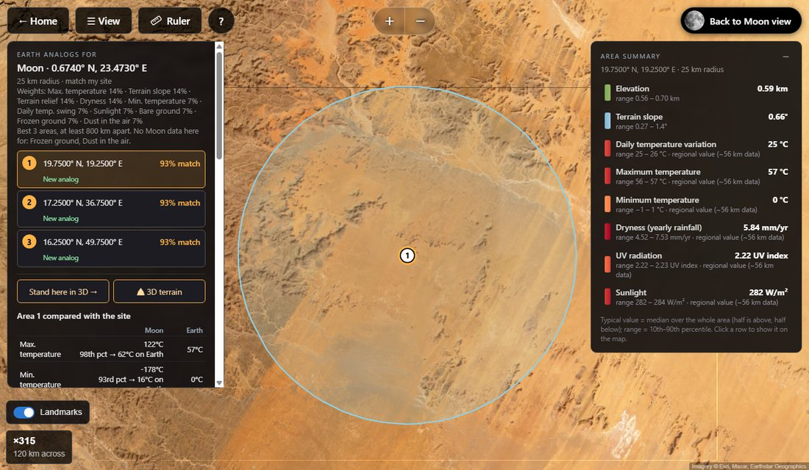
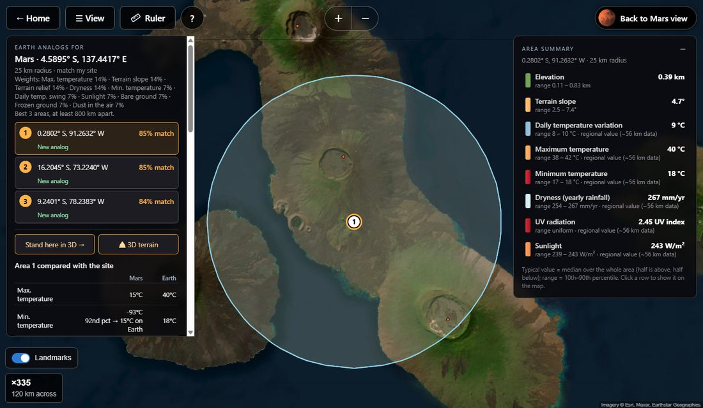
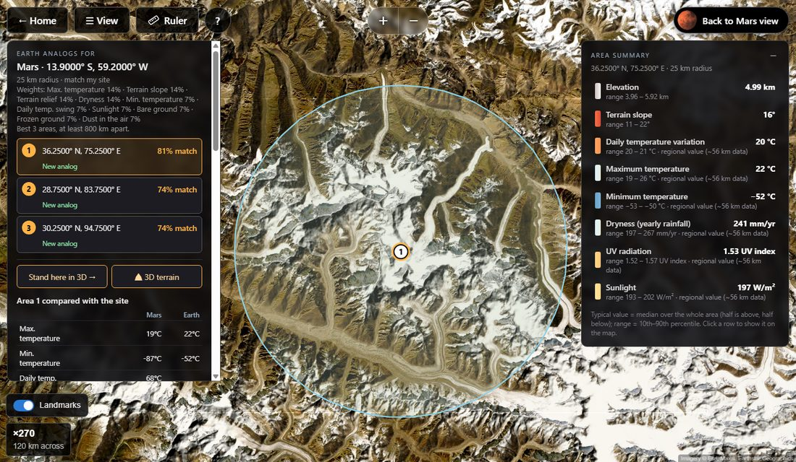

# Planet Maps: finding Earth analogs for the Moon and Mars

Pick any spot on the Moon or Mars and Planet Maps searches every land area on Earth for the places most like
it, using open data from NASA and partner agencies on all three worlds. Each result comes with a report card:
what matches, what doesn't, whether the place is already a known analog, and what no place on Earth can
reproduce.

**Open the app:** https://gumenion594-ai.github.io/nasa-project/ (no install needed) ·
NASA Space Apps Challenge 2026

## What we found

Three analogs from the search, each a strong match on several characteristics and none of them an
established analog site. All use the default weights and a 25 km radius; the links open the same search in the
app. Values are area averages from the data described in [METHODS.md](METHODS.md).

### 1. Apollo 11's landing plain ↔ the Borkou plains of northern Chad

Mare Tranquillitatis, where Apollo 11 landed, against all of Earth: the best match (93%) is a bare plain in
northern Chad, 66 km from the Aorounga impact crater.
[Open this search](https://gumenion594-ai.github.io/nasa-project/#/earth?from=moon&site=0.674,23.473&sr=25&w=tmax:2,tmin:1,swing:1,slope:2,relief:2,dry:2,sun:1,bare:1&mode=match&n=3)

| | Moon (Apollo 11) | Chad | |
|---|---|---|---|
| Terrain slope | 0.65° | 0.65° | ✓ strong |
| Terrain relief | 31 m | 34 m | ✓ strong |
| Rain | – | 6 mm a year | ✓ hyperarid |
| Bare ground | all | 100% | ✓ strong |
| Hottest afternoon | 122 °C | 57 °C | ↕ rank only: both ~98th percentile of their world |
| Coldest night | −178 °C | 0 °C | ↕ rank only: both ~93rd percentile |
| Sunlight | 433 W/m² | 283 W/m² | ↕ rank only: both the sunniest of their world |

**Doesn't match:** the rock: sandstone and wind-blown sand instead of mare basalt (rock type isn't compared).
Wind shapes everything here; the Moon has none. And the temperatures only match in rank: the Moon's swing is
300 °C, Chad's 25 °C.
**What it could be used for:** landing and driving on a plain as flat and bare as a lunar mare, with no
vegetation or water to complicate navigation or remote sensing, and a real impact crater (Aorounga, 13 km)
within a day's drive for impact-geology training.

### 2. Gale crater (Curiosity) ↔ Isabela Island, Galápagos

The best match (85%) for Gale crater is the young basalt shield volcanoes of Isabela Island, between the Darwin
and Alcedo volcanoes.
[Open this search](https://gumenion594-ai.github.io/nasa-project/#/earth?from=mars&site=-4.5895,137.4417&sr=25&w=tmax:2,tmin:1,swing:1,slope:2,relief:2,dry:2,sun:1,bare:1,frozen:1,dust:1&mode=match&n=3)

| | Mars (Gale) | Isabela | |
|---|---|---|---|
| Terrain slope | 3.3° | 4.2° | ✓ strong |
| Terrain relief | 213 m | 200 m | ✓ strong |
| Bare ground | all | 57% | ✓ strong |
| Rain | – | 275 mm a year | ✓ almost desert-dry |
| Frozen ground | no ground ice | never frozen | ✓ strong |
| Hottest afternoon | 15 °C | 40 °C | ≈ partial |
| Coldest night | −93 °C | 18 °C | ↕ rank only |

**Doesn't match:** Gale's rocks are lake and river sediments (Mount Sharp); Isabela's are fresh lava. The
upper slopes are green, the ocean keeps nights warm, and the islands are a national park and World Heritage
Site, so field tests would need permits: it is a better analog for imagery and data than a test range.
**What it could be used for:** comparing how basalt, Mars's most common rock, weathers in a dry climate, from
orbit and on the ground; and training rover image analysis on a volcanic surface at the same slopes and relief
as Gale.

### 3. Valles Marineris ↔ the Karakoram near the Shimshal valley

For the walls of Mars's great canyon (13.9° S, 59.2° W), the best match (81%) is the Karakoram near the
Shimshal valley (Gilgit-Baltistan, Pakistan).
[Open this search](https://gumenion594-ai.github.io/nasa-project/#/earth?from=mars&site=-13.9,-59.2&sr=25&w=tmax:2,tmin:1,swing:1,slope:2,relief:2,dry:2,sun:1,bare:1,frozen:1,dust:1&mode=match&n=3)

| | Mars (Valles Marineris) | Karakoram | |
|---|---|---|---|
| Terrain relief | 549 m | 539 m | ✓ strong |
| Terrain slope | 7.8° | 14° | ✓ strong (steeper here) |
| Hottest afternoon | 19 °C | 22 °C | ✓ strong |
| Rain | – | 231 mm a year | ✓ desert-dry |
| Bare ground | all | 60% | ✓ strong |
| Coldest night | −87 °C | −52 °C | ≈ partial |
| Frozen ground | no ground ice | −6 °C yearly mean: permafrost | ✗ weak |

**Doesn't match:** the Karakoram is a mountain range pushed up by colliding plates and carved by glaciers;
Valles Marineris is a rift that pulled apart. Its ground is frozen and glaciers fill the valleys; Valles
Marineris is dry. The canyon is up to 7 km deep over thousands of km; the match is at the ~10 km scale of its
walls.
**What it could be used for:** route planning, navigation and communication in deep, steep-walled terrain
where slopes exceed rover limits and valley walls block the sky; studying the rockfalls and landslides that
line both.

## Does the search work?

- **It finds known analogs.** For six Moon and Mars sites with an established Earth analog (e.g. Phoenix ↔
  McMurdo Dry Valleys, Apollo 15 ↔ Askja), the known analog ranks above a random place on Earth for five,
  three of them in the top 5% of all ~96,000 areas. The sixth (Viking 1 ↔ Atacama) was chosen for soil
  chemistry, which the search can't compare.
- **Its results are mostly new.** Over 20 sites × 10 results, 94% are more than 250 km from any of 25
  established analog sites; *Only new places* in the search dialog removes the rest.
- Details and the check itself (`tools/validate-analogs.html`): [METHODS.md](METHODS.md#known-analogs-is-the-place-new).

## Where the analogy breaks down

**What no place on Earth can reproduce:** the Moon's 1/6 and Mars's 3/8 gravity; the Moon's vacuum and Mars's
thin CO₂ air (0.6% of Earth's pressure); their radiation (no magnetic field: Curiosity measured ~0.7 mSv a
day, about a year of Earth's natural dose every 3–4 days); the Moon's two-week days and nights; Mars's
perchlorate-laden soil; and sterility: Earth has life almost everywhere. Every report card lists these.

**What the search doesn't compare (yet):** rock type and minerals, surface material (dust vs rock), and impact
craters (shown on the map and in the report card, but not scored). Temperatures, sunlight and dust that are
beyond anything on Earth are only matched by rank, never in absolute value, and every report card says which.
The Earth search grid is 0.5° (~50 km); results for small radii are positioned with ~5 km terrain data.

## Run it

Requires Node.js 18+ (https://nodejs.org) and Git (https://git-scm.com).

**Easiest:** double-click `start.bat` (Windows) or `start.command` (Mac).
It pulls the latest changes, installs dependencies and opens the app in your browser.
Close that window to stop the app.

Or by hand: `npm install`, then `npm run dev`.

The online version is published with GitHub Pages: `.github/workflows/pages.yml` builds the site
(`npm run build`), pushes it to the `gh-pages` branch and publishes it every time `main` changes.

## Using it
- Click a world on the home page to open its map; **← Home** (or the browser back button) returns.
- Zoom with the mouse wheel, pinch, or the **+ / −** buttons. The bottom-left box shows the
  zoom factor (×1 = whole map filling the screen) and how wide the view is.
  Maximum zoom is 1 km across the screen. The map doesn't repeat sideways.
- On the Moon and Mars, click anywhere to select an area; its coordinates show in the panel.
  Click elsewhere to move it.
- **Area summary** (top right, appears with a selection): every characteristic's typical value
  over the whole circle - the area-weighted median - plus its 10th-90th percentile range. Rows
  marked "regional value" use data coarser than the circle. Click a row to show that view.
  The tiles store each layer's full value range, so these are real values, not clipped to the
  colour scale.
- **Earth view / Back to Mars (Moon) view** (top right): switch between Earth and the Moon or
  Mars. Going back restores the Moon/Mars map exactly as you left it.
- **Earth** has its own views, area selection and area summary (no analog search from Earth):
  elevation, slope, daily temperature swing, maximum and minimum temperature, dryness (yearly
  rainfall; red = driest) and UV radiation. Oceans are transparent.
- **Projection** (top of the ☰ View panel, all three worlds): Equirectangular, Mercator, North
  pole or South pole (azimuthal equidistant: the whole world as a disc centred on the pole, like
  the UN emblem; distances from the pole are true). The map sources
  stay the same; other projections are drawn by warping the source tiles in the browser
  (`src/reproject.js`). Selection, views, radius and the area summary carry over; the projection
  is kept in the address (`proj=`).
- **☰ View** (Moon and Mars): show one coloured data layer over the map (blue = low, red = high,
  with a legend). See [Map views](METHODS.md#map-views-data-and-method) for what's available on each body.
- Selection panel (bottom right): coordinates, the **Find** buttons and the selection **radius**
  (a slider from 1 to 250 km, logarithmic so small sizes get as much room as big ones; default 10).
- **Ruler** (top left, next to Home / View): measure the distance between two points (great-circle
  distance on the planet's sphere, correct in every projection). While measuring, everything else on the page
  is switched off except moving and zooming the map; click a start point, move the cursor (live distance),
  click an end point. The next click starts a new measurement. **×** (or Esc) ends it.
- **Tutorial**: on the first visit a welcome card offers a short guided tour of the main tools (View, area
  summary and radius, ruler, route planner once it exists, Find Earth analogs, Find similar spots). A click
  anywhere moves to the next step. It's shown once per browser, and any time from the **?** button (top left on
  the maps).
- Bottom-left: **Landmarks** on/off (on every time a map opens). **Find Earth analogs** searches Earth for
  the places most like the selected area (see [Earth analog search](METHODS.md#earth-analog-search)); **Find similar spots**
  searches the same world (see [Similar spots](METHODS.md#similar-spots)).
  The selection is kept in the address (e.g. `#/mars?lat=18.44&lon=77.45&r=10&view=slope`), so links and the
  back button bring it back.
- The home page shows spinning 3D globes of the Moon and Mars (three.js, textures made from the
  NASA Trek maps), drawn to scale. Mars turns once every 30 s; the Moon 28x slower.
  Change the speed with `MARS_SECONDS_PER_TURN` in `src/main.js`. The Earth map is reached via
  **Find Earth analogs**.

## Route planner (A to B), Mars and Moon

On the Mars map (and the Moon map, see *On the Moon* below), **🧭 Plan a route from A to B** (selection panel) opens the route planner.
Click the start (A), then the destination (B); drag either pin to change the route. As soon as
the route is calculated, the map zooms so the whole route fills the space next to the panel (in 3D,
the camera flies to a tilted view of the route, centred between the panels). It finds
three routes and shows what's dangerous on each:

| Route | What it minimises |
|---|---|
| **Safest** (orange) | distance x (1 + hazards): steep slopes ×3, crater rims ×1.5, rough ground ×1.5, loose dust ×1 (rover ×2), dust storms ×1 |
| **Easiest** (green) | on foot: walking time (Tobler's hiking function on the up/down grade); rover: distance + 10 × uphill grade + loose dust |
| **Shortest** (blue) | kilometres |

All three avoid ground steeper than the traveller's limit: **20°** on foot (NASA xEVA spacesuit
concept of operations, EVA-EXP-0042) and **25°** for a rover (Curiosity's steepest tilt in 7 years,
25.3°; Rankin et al., JPL). Slopes over **15°** count as "caution" (Mars 2020's "benign terrain" limit;
Apollo walking traverses stayed under it). Options: who travels, and the **season** (dropdown next
to the A / B coordinates: Ls 0–90°, 90–180°, 180–270°, 270–360°; dust storms depend on it).
Each traveller's specs and its **model assumptions** are in the collapsible profile (▾ specs).

For the chosen route the panel shows: distance, time (walking hours or rover driving sols at
Curiosity's average ~29 m per drive), climb and descent, elevation range, steepest slope and
km over 15°, crater rims crossed with the deepest crater's depth, km of loose dust, how often dust
storms cover the route in that season, the coldest night, an elevation profile coloured by slope
(hover to find the spot on the map) and a list of dangers with map markers. Each number says
whether it's *measured* (spacecraft data), from the *catalog*, *observed* or a *model*.

How it works (`src/route/`):
- `grid.js` cuts a box around A and B (a third of the distance added on every side) into cells as
  fine as the slope data (~2.6 km), coarser for long routes (at most 220,000 cells). Each cell reads
  the same data tiles as the map's views: steepest and mean **slope** and mean **elevation** (MOLA),
  **roughness** (relief), **loose dust** (TES thermal inertia below ~150 TIU), **coldest night**
  (thermal model), plus **craters** and **dust storms** from `public/route/`.
- Crater hazard: the rim and inner wall (0.7–1.15 × the radius) of every crater at least half a
  cell wide; small bowl-shaped craters (< 7 km) all the way across; scaled by depth (1 km = full
  hazard), eroded rims count 60%. Where the catalog has no depth, ~1/5 of the width is used and the
  panel says "~" (estimated).
- `search.worker.js` runs A* (16 neighbours per cell) in a Web Worker, three times.

Limits: the data is ~2.6 km per cell at best (slope, elevation), 3–9 km (dust, roughness), 60 km
(temperatures) and 2° (storms). Routes are **corridors**, not paths a rover could drive without
closer images: boulders, small scarps and slopes steeper than the ~2 km average aren't visible.
Crater depths of craters under 10 km are rough (MOLA). Tobler's walking speeds come from people on
Earth. **Wind** isn't included yet: there is no measured global wind map of Mars, only climate
models (NASA Ames Mars GCM, Mars Climate Database).

Data for the planner is built with `python3 tools/build_route_data.py` (inputs in `data/raw/`, see
the script): the Robbins crater catalog into `public/route/craters/` (30° blocks, loaded only
where a route goes) and the dust-storm database into `public/route/storms.bin`.

### On the Moon

The same planner works on the **Moon map** (same button, same three routes, same 3D terrain button
once A and B are set). What differs:

- **Data**: slope, elevation and roughness from LRO **LOLA**, loose dust and rocky ground from
  **Diviner** thermal inertia (on the Moon it only spans ~25–60 TIU, so "loose" is below ~30 and
  "rocky" above ~60, the ends of the Moon's own range), coldest night measured by Diviner.
- **Craters**: the Robbins (2019) lunar crater catalog, 910,000 craters ≥ 1.3 km in
  `public/route/moon/craters/` (same 12-byte format). It has no depths, so
  `node tools/build_moon_route_data.mjs` measures the rim-to-floor depth of every crater ≥ 15 km
  from LOLA (`data/raw/ldem_16.img`; e.g. Tycho 4.7 km, Copernicus 3.7 km). Smaller craters use
  Pike's (1977) depth–diameter relation for fresh lunar craters (0.196 × D below 15 km). The giant
  impact basins (> 300 km, e.g. Imbrium) are not counted as crater rims: their rims are mountain
  rings hundreds of km wide, which the slope data already shows.
- **No seasons, no dust storms** (no weather): the season dropdown is hidden.
- **Who travels**: an astronaut on foot (20°, as on Mars), the **Apollo Lunar Roving Vehicle**
  (25° design limit; time at ~8 km/h, the Apollo 15–17 average; 92 km battery range). Routes
  longer than Apollo 17's 35.9 km, the farthest NASA has driven on the Moon, get a warning.

### Rovers: who travels changes the route

**Who travels** offers an astronaut on foot and NASA's five Mars rovers: **Sojourner, Spirit,
Opportunity, Curiosity, Perseverance**. Each has a compact profile (mission, dates, mass, wheels,
obstacle clearance, speed, navigation; every fact with its source, hover ⓘ) and its own **model
parameters** in `src/route/rovers.js`, clearly marked as assumptions:

| | Slope limit (~2 km scale) | Hazard weights: slope / crater rim / rough / loose dust / rocky / dust storm | Why |
|---|---|---|---|
| On foot | 20° (xEVA spec) | 3 / 1.5 / 1.5 / 1 / 0.5 / 1 | |
| Sojourner | 20° (assumption) | 3 / 3 / 4 / 1 / 2 / 1 | 13 cm wheels clear ~20 cm: rough ground and rims count most |
| Spirit, Opportunity | 25° (MER test rover stalled on ~25° sand) | 3 / 2 / 3 / 3 / 1 / 1 | 26 cm wheels; both got stuck in sand |
| Curiosity | 25° (steepest tilt in 7 years 25.3°) | 3 / 1.5 / 1.5 / 2 / 2.5 / 0.5 | 50 cm wheels clear ~65 cm, but sharp rocks damaged them; nuclear power |
| Perseverance | 25° (assumption: Curiosity design) | 3 / 1.5 / 1.2 / 2 / 1 / 0.5 | thicker wheels after Curiosity's damage |

"Rocky" = high TES thermal inertia (> 600 TIU: rock and bedrock at the surface). Single rocks
are far too small for this data, so obstacle clearance only sets how much a rover dislikes rough
ground and crater rims. With these weights the same A and B can give different routes: e.g. across
Valles Marineris Spirit's safest route is ~885 km, Curiosity's ~635 km.

The panel then explains the chosen route: **why** (how much longer than the shortest and what for),
**what it avoids** compared with the shortest route (km of steep slopes, crater rims, dust, rocky
and rough ground), the **difficult sections**, and a **verdict**: passable under the model (every
cell below the rover's limit), or beyond the rover's capabilities (Sojourner had to stay within
~10 m of its lander; Spirit drove 7.7 km in total). Routes longer than Opportunity's 45.16 km
record get a warning. **Terrain difficulty** is the hazard per km (model). **Time** is shown only
where there's a defensible pace: walking (Tobler), Curiosity (~29 m per drive), Spirit and
Opportunity (lifetime averages from NASA's totals); none for Sojourner and Perseverance.

`computeRoutes()` in `planner.js` is separate from the UI, so comparing two rovers on the same A
and B later only means calling it twice (the terrain grid can be reused).

## 3D terrain (Mars)

**⛰ 3D terrain** (top bar) turns the area into a 3D landscape (`src/terrain3d/view3d.js`, three.js):
the route's area if there is a route, otherwise the area the 2D map shows (up to 1,000 km).

- **Real elevation**: the MOLA elevation tiles the map uses (~2.6 km per pixel). The tiles store
  heights in ~115 m steps (8 bits); instead of blurring, the 3D view finds the smoothest surface
  that keeps every data pixel inside its own step (smoothing passes, each clamped back to the
  allowed range), then interpolates bicubically. Plains lose their fake terraces while cliffs and
  crater walls stay sharp, and every height stays within what NASA measured. No artificial
  shapes are added. Big craters, Mount Sharp, canyons and volcanoes show their real shape;
  craters under ~10 km are blurred.
- **Controls**: drag to rotate, tilt down to just above the horizon, right-drag (or Ctrl/⌘-drag)
  to pan, scroll or pinch to zoom (towards the cursor). **Top view** and **Reset**.
  Near and far clipping follow the camera, so you can zoom right in.
- **3 × 3 tiles**: the route's area is the middle tile (the route plus a small margin, at least
  80 km), with one tile of the same size on every side and corner. The whole model uses the most
  detailed elevation tiles, at 769 × 769 vertices (~256 per tile), smoothed only as much as needed
  to hide the 115 m storage steps, with sharp shadows over the whole model, no haze, and side walls
  down to a base like a physical terrain model.
- If the 2D map shows the whole planet, 3D opens on **Gale Crater** and says how to pick another place.
- **Heights ×5 (default) or ×10**: vertical exaggeration, always shown.
- Elevation colours are lighter where TES thermal inertia says the ground is dusty and darker where
  it's rocky (real data).
- **Colour by**: elevation or slope.
- Lighting: a low afternoon sun from the north-west with shadows, plus soft sky light.
- **Routes in 3D**: click the ground to set A and B (opens the planner). The chosen route follows
  the surface; its difficult parts (steep, crater rim, loose dust, rocky) are **red**; A and B are
  pins; dangers float above the route. Hovering the elevation profile moves a marker along the
  route, and clicking a danger in the list flies the camera there.
- The surface is drawn flat around the area's centre (no planet curvature).

Upgrade path for sharper 3D: NASA/USGS's HRSC-MOLA blended elevation (200 m per pixel, global)
would need its own 16-bit elevation tiles (the current ones are 8-bit, 2.6 km).

## Data and methods

- [METHODS.md](METHODS.md): how every map layer, the analog search, its report card and validation, simulation
  planning (equipment, cost and team to recreate a site's environment at an analog), finding sites by
  criteria (landing-site presets), similar spots, the 3D views and the thermal models work, and how to rebuild the data.
- [DATA_SOURCES.md](DATA_SOURCES.md): every NASA and partner data set, with dataset IDs.

## Credits

> **Mars Rover Route** · NASA Space Apps Challenge 2026. Built on *Planet Maps* by
> [gumenion594-ai](https://github.com/gumenion594-ai/nasa-project) (maps, data layers, Earth analog
> search). Added here by Francesca Olea: the **Mars route planner** (safest / easiest / shortest
> routes with their dangers), **rover-aware routing** (Sojourner, Spirit, Opportunity, Curiosity,
> Perseverance) and the **interactive 3D terrain** view. See *Route planner* and *3D terrain* above.
